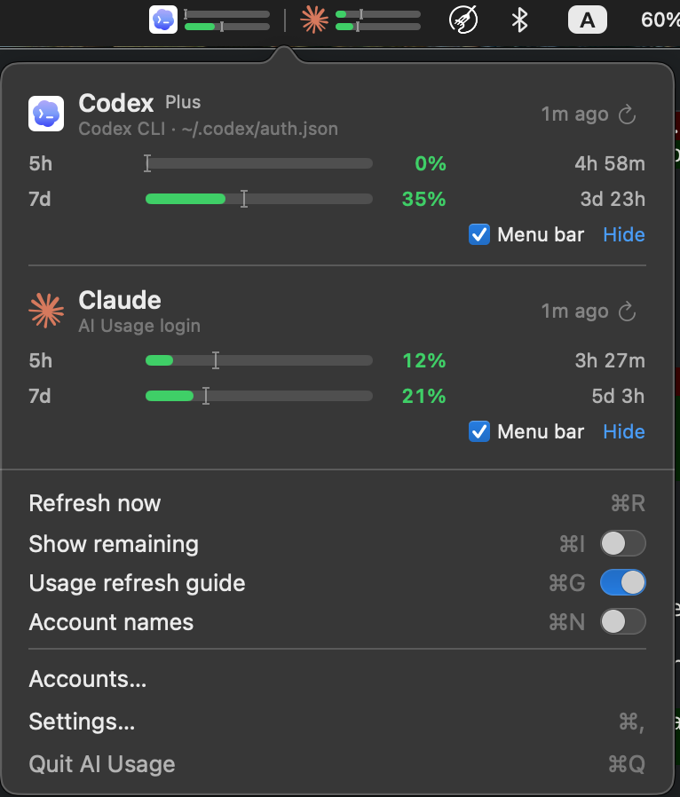

# AI Usage

A native macOS menu bar app that shows how much of your AI coding subscriptions you've used:
**Claude, Codex, GLM (Zhipu / Z.ai), DeepSeek, MiniMax and Kimi**.

<p align="center"></p>

- **At a glance:** each account shows two bars in the menu bar, 5-hour on top and weekly below. They're
  green below 70%, amber from 70% and red at 90%+.
- **Details on click:** percentages, time until each limit resets, and how old the numbers are.
  Click `⟳` on an account to update it now.
- **Pace check:** a small `I` cursor on each bar shows how far the window has run toward its reset.
  If usage reaches past the cursor, you're on track to hit the limit early.
- **Zero setup:** it finds logins you already have in Claude Code, Codex CLI, OpenCode and Pi,
  without changing anything they've stored.
- **More accounts:** you can sign in to more accounts, including several for the same provider, or add API keys.
- **Gentle polling:** checks back less often while usage doesn't change, and backs off when a
  provider asks it to slow down.

## Install

Requires an Apple Silicon Mac (M1 or later) with macOS 14 (Sonoma) or later.

1. Download `AIUsage-<version>.zip` from the
   [latest release](https://github.com/wawaka/ai-usage/releases/latest) and unzip it.
2. Move **AI Usage.app** to `/Applications`.
3. Open it. The first time, macOS says it can't verify the developer, because the app isn't
   notarized. Either:
   - right-click the app → **Open** → **Open**, or
   - run `xattr -dr com.apple.quarantine "/Applications/AI Usage.app"` and open it normally.

The app lives only in the menu bar, with no Dock icon. To start it automatically, turn on
**Settings → Launch at login**.

### Build from source

With Xcode 26+ or its Command Line Tools (Swift 6.2+):

```sh
git clone https://github.com/wawaka/ai-usage.git && cd ai-usage
Scripts/package_app.sh                      # → build/AI Usage.app and dist/AIUsage-<version>.zip
cp -R "build/AI Usage.app" /Applications/
```

A locally built app opens without the Gatekeeper warning. See [docs/DEVELOPMENT.md](docs/DEVELOPMENT.md)
for the development workflow.

## Getting started

**Accounts you're already logged in to show up on their own.** If you use Claude Code, Codex
CLI, OpenCode or Pi on this Mac, their accounts appear within a few seconds.

- **Keychain prompt:** Claude Code keeps its login in the Keychain, so macOS asks once whether
  AI Usage may read it. Choose **Allow**, not *Always Allow*: that leaves Claude Code's
  Keychain entry exactly as it is. If you'd rather not be asked, turn off **Settings → Read
  Claude Code login from Keychain** and sign in to Claude in AI Usage instead.
- **Expired logins:** AI Usage never renews another tool's login. If one expires, its card says
  so. Open that tool once and it renews itself.

**Adding accounts.** Use **Accounts… → Add Account**:
- **Claude or Codex:** sign in through your browser. If the browser can't get back to the app,
  paste the code or the final URL instead.
- **GLM, DeepSeek, MiniMax or Kimi:** paste an API key. It's checked before it's saved.

**Customising.** The switches at the bottom of the dropdown cover the common options:
- **Show remaining** (⌘I): quota left instead of used.
- **Usage refresh guide** (⌘G): the `I` cursors.
- **Account names** (⌘N): hide emails, e.g. for screenshots.

**Per account:**
- **Menu bar** checkbox: keep the account in the dropdown but not the menu bar.
- **Hide:** remove it from the list. Bring it back in Accounts….

**Settings also has:**
- the menu bar layout (all accounts, most urgent only, or just an icon) and style (bars, percentages, or both)
- how often to check

## Privacy

- **Network:** AI Usage only talks to the providers' own servers.
- **Other tools' logins:** it reads their files and Keychain entries but never changes them.
- **What it writes:** only its own data, in `~/Library/Application Support/ai-usage/`, its own
  Keychain entries (`dev.ai-usage.*`) and its preferences.

Details are in [docs/HOW-IT-WORKS.md](docs/HOW-IT-WORKS.md).

## Uninstall

1. Quit AI Usage from its dropdown and delete **AI Usage.app**.
2. Optionally remove its data:
   ```sh
   rm -rf ~/Library/Application\ Support/ai-usage
   defaults delete dev.ai-usage.app
   ```
   Then, in **Keychain Access**, search for `dev.ai-usage` and delete those entries.

## Notes

- Claude and Codex usage comes from the same undocumented endpoints their official CLIs use, so
  it may break if those change.
- Provider logos are from [Lobe Icons](https://github.com/lobehub/lobe-icons). They belong to
  their owners and are used only to identify each provider.
- Inspired by [coding-usage-bar](https://github.com/hanzhangzzz/coding-usage-bar).
